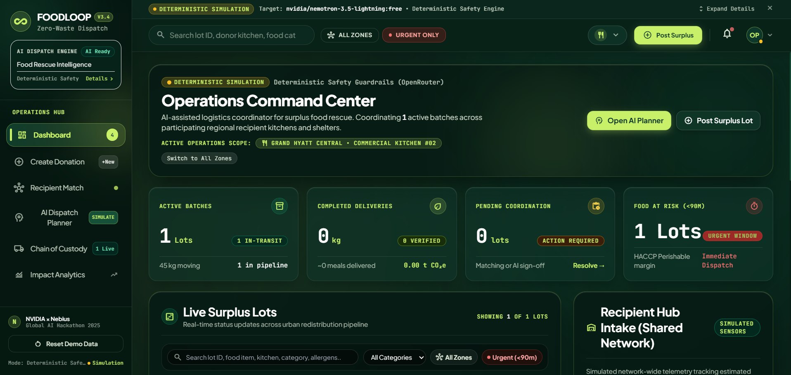
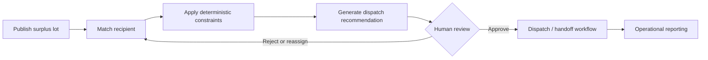
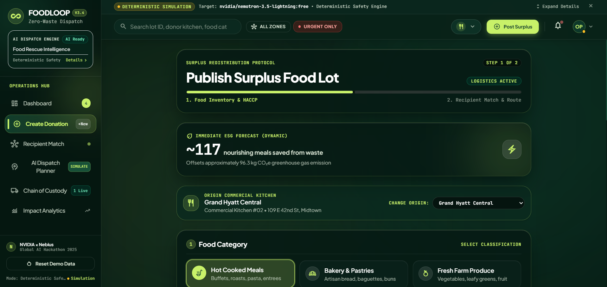
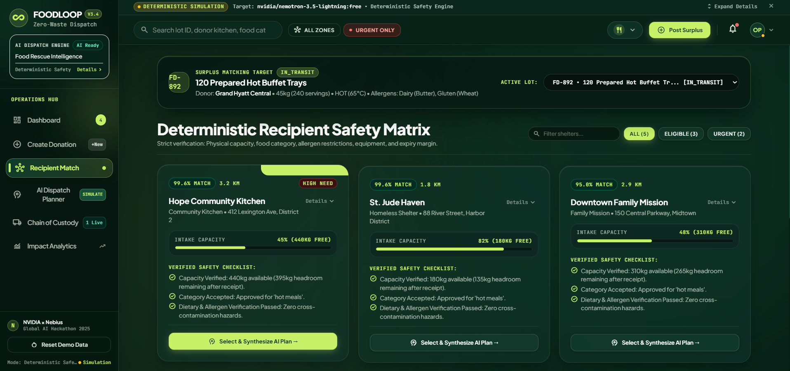
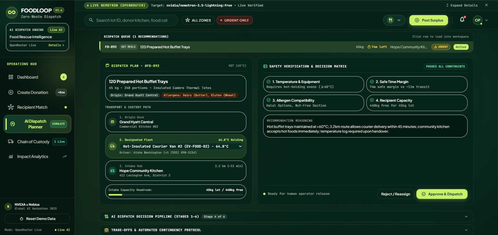
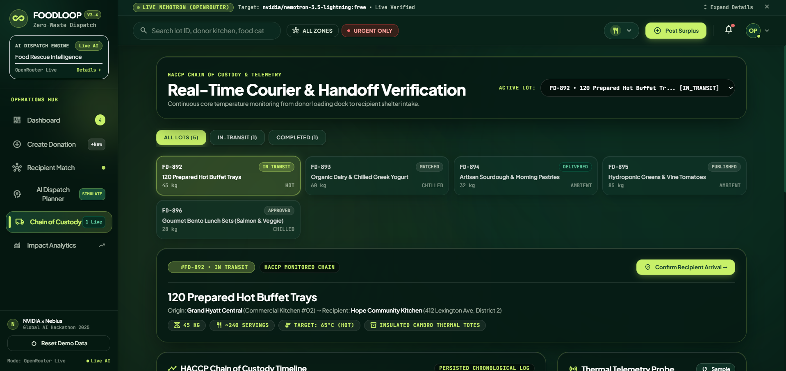
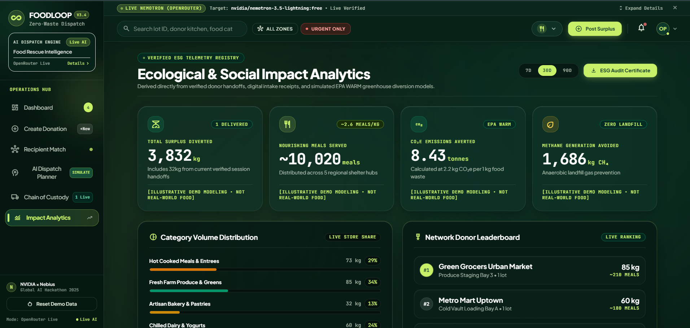
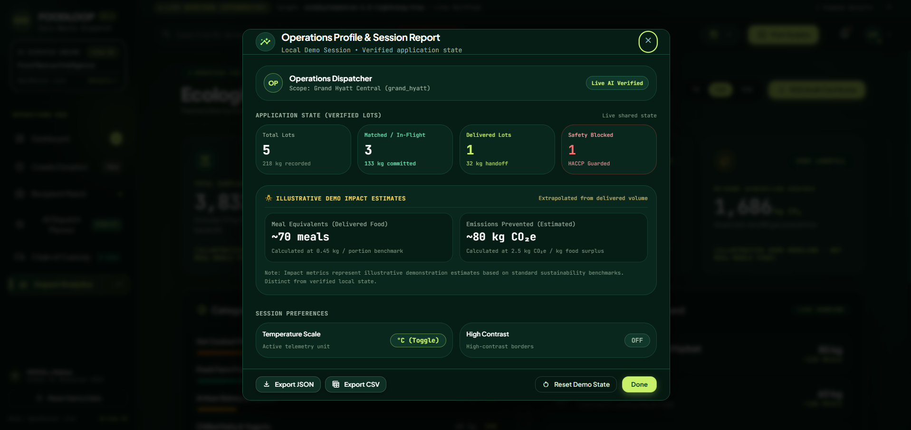
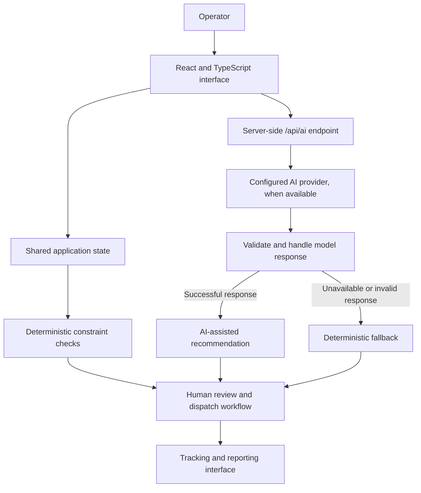

<div align="center">

# FOODLOOP

### Rescue surplus. Coordinate smarter. Waste less.

**An AI-assisted surplus-food redistribution and dispatch coordination platform.**

FOODLOOP brings surplus donation management, recipient matching, safety constraints, dispatch planning, handoff tracking, and impact estimates into one operational workspace.

<p>
  <a href="https://foodloop-tau.vercel.app"><strong>🚀 Live Demo</strong></a>
  &nbsp;·&nbsp;
  <a href="https://github.com/CodeeSAI/foodloop"><strong>💻 Source Code</strong></a>
</p>



<sub>Product screenshots from the FOODLOOP demonstration interface. Some operational records and telemetry shown are illustrative demo data.</sub>

</div>

---

## 🌱 The problem

Edible surplus can be wasted when donors and recipient organizations cannot coordinate quickly enough. Matching a food lot to a suitable recipient involves more than distance: quantity, recipient capacity, food category, allergens, equipment compatibility, and time remaining can all matter.

## 💡 The FOODLOOP approach

FOODLOOP provides a shared workflow for coordinating surplus food lots from publication through recipient matching and dispatch review. AI-assisted recommendations can help summarize operational trade-offs, while coded deterministic constraints remain responsible for the checks implemented by the application.

### Core workflow



---

## ✨ Product walkthrough

### 1. Operations dashboard

A command-center view of active lots, coordination needs, urgent food windows, and the current operational scope.


### 2. Create a donation

Publish a surplus lot by classifying the food and recording relevant inventory and handling information. The screenshot shows the first step of the donation flow.



### 3. Recipient matching

Review candidate recipient organizations alongside capacity and the deterministic eligibility checks displayed by the demo.



### 4. AI dispatch planner

Inspect a dispatch recommendation, its stated reasoning, route/workflow details, and the safety constraint matrix before a human operator approves or rejects the proposed plan.



### 5. Chain of custody

View food lots and the handoff workflow. The current interface includes illustrative telemetry; the screenshot alone does not establish a connection to physical sensors or a live courier network.



### 6. Impact analytics

Explore operational indicators and sustainability calculations. Values marked as illustrative demo modeling are estimates, not independently verified environmental outcomes.



<details>
<summary><strong>Operations profile and session report</strong></summary>

The report brings session-level lot counts, safety-blocked counts, illustrative impact estimates, and session preferences into a compact modal.



</details>

---

## 🧠 AI-assisted planning with deterministic guardrails

The application is designed to separate language-model assistance from explicit application rules.

- **AI-assisted recommendations:** the configured model can help synthesize a dispatch recommendation and explain operational trade-offs.
- **Deterministic constraints:** coded checks evaluate supported rules, such as recipient capacity, food category, allergen restrictions, equipment compatibility, and time/safety margins where implemented.
- **Human approval:** dispatch recommendations are presented for operator review rather than treated as proof that a physical delivery occurred.
- **Fallback behavior:** when the AI provider is unavailable or a request fails, the application can use deterministic fallback behavior. A fallback result should not be described as live model inference.

The screenshots show both **Deterministic Simulation** and **Live Nemotron (OpenRouter)** states. The active execution mode can vary; the label in the running application and successful server-side request logs should be used to verify whether a particular result came from live inference.

### Architecture at a glance



> **Infrastructure note:** The visible production UI identifies the model as `nvidia/nemotron-3.5-lightning:free` through OpenRouter. Do not describe this as a direct Nebius Token Factory or Nebius AI Cloud deployment unless the deployed application is separately verified to use that infrastructure.

---

## 🧰 Technology

The repository's configuration is the source of truth for exact dependency versions and available scripts.

| Technology / component | Role |
|---|---|
| React | Component-based user interface |
| TypeScript | Typed application code |
| Vite | Development server and frontend build |
| Vercel | Web deployment and server-side API hosting |
| OpenRouter + configured Nemotron model | Optional AI-assisted dispatch reasoning, subject to provider availability |
| Deterministic constraint engine | Application-defined safety and eligibility checks |
| GitHub | Source control and project collaboration |

Check `package.json`, `api/`, `src/`, `vite.config.ts`, and `vercel.json` for current implementation details.

---

## 🚀 Run locally

### Prerequisites

- Node.js compatible with the version used by the project
- npm
- Git

### Setup

```bash
git clone https://github.com/CodeeSAI/foodloop.git
cd foodloop
npm install
```

Create a local `.env.local` file based on the repository's `.env.example`, if present. Use the **exact variable names documented by the current server-side API implementation**. Never commit `.env.local`, API keys, or other secrets.

Start the development server:

```bash
npm run dev
```

Open the local URL printed by Vite in your terminal.

### Quality checks

Run the scripts that exist in `package.json`. In the current development workflow, these have included:

```bash
npm run lint
npm test
npm run build
```

If a script is not present in the current checkout, use the scripts listed by `npm run` rather than assuming it exists.

---

## ☁️ Deployment

The public demo is hosted on Vercel:

**[foodloop-tau.vercel.app](https://foodloop-tau.vercel.app)**

To deploy your own instance:

1. Import `CodeeSAI/foodloop` into Vercel.
2. Confirm the project uses the repository's Vite and `vercel.json` configuration.
3. Add the required **server-side** environment variables in Vercel Project Settings.
4. Deploy and inspect the build logs.
5. Test the deployed `/api/ai` endpoint and inspect Runtime Logs.
6. Confirm live model inference from a successful upstream response; an HTTP 200 response alone may represent a deterministic fallback.

Free model availability, latency, quotas, and rate limits can vary. Keep provider credentials on the server and never expose them in client-side code.

---

## ⚠️ Demo scope and limitations

FOODLOOP is a software demonstration. Please interpret the interface accordingly:

- Sample donations, organizations, drivers, addresses, routes, and telemetry may be illustrative.
- Displayed temperatures should not be treated as readings from a physical sensor unless a real sensor integration is present and verified.
- A simulated pickup, approval, or handoff is not proof of a real-world delivery.
- Environmental and meal-equivalent figures are estimates based on stated assumptions, not independently measured impact.
- Safety checks cover the rules implemented in code; they do not replace applicable food-safety procedures or qualified human judgment.
- AI-generated explanations may be inaccurate. Operators must review recommendations and must not bypass safety constraints.
- This README does not claim regulatory certification, verified NGO partnerships, tamper-proof records, or live fleet integrations.

---

## 🗺️ Project areas

Explore the repository for the current implementation of:

- `src/` — frontend application and views
- `api/` — server-side AI endpoint and related logic
- `tests/` — automated tests
- `vite.config.ts` — Vite development configuration
- `vercel.json` — Vercel routing/deployment configuration
- `.env.example` — documented environment-variable template, if present

The exact structure may evolve; inspect the repository for current paths.

---

## 🔭 Potential next steps

Possible future improvements, subject to implementation and validation:

- Integrations with real donor and recipient organizations
- Verified temperature-sensor and courier integrations
- More robust production observability and AI-provider health reporting
- Stronger audit trails for operator decisions
- Additional accessibility and multilingual improvements
- Field testing with food-rescue partners and validated impact methodology

These are potential directions, not claims that the features are already implemented.

---

## 👥 Team

<div align="center">

**Made by Team DuoFlash**

Built to explore how AI-assisted coordination and explicit safety constraints can help make surplus-food redistribution workflows easier to manage.

**[Live Demo](https://foodloop-tau.vercel.app) · [GitHub Repository](https://github.com/CodeeSAI/foodloop)**

</div>
